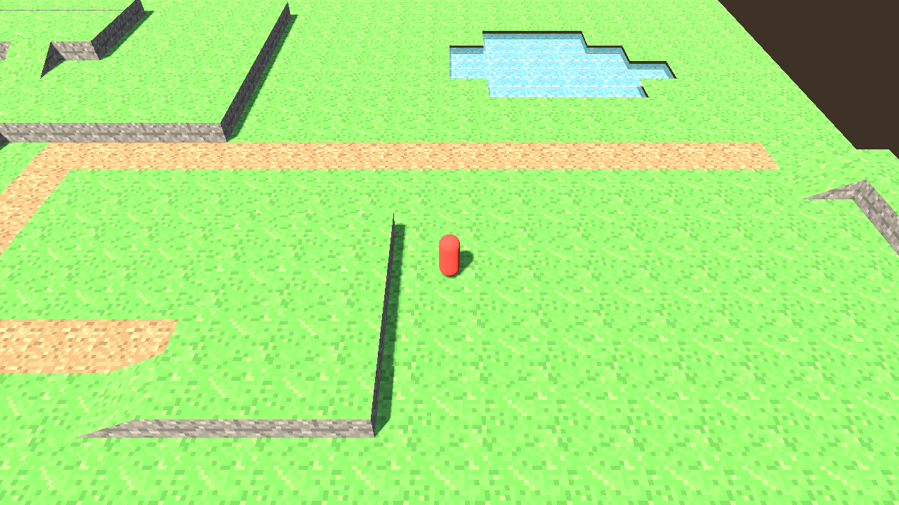
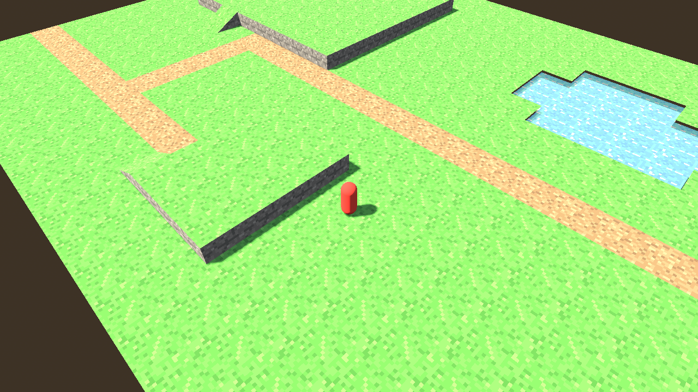

# Game camera

The game camera follows the player at a fixed 45° pitch, like Ragnarok Online.

| Default view | After pressing **Q** once |
| --- | --- |
|  |  |

## Controls

| Input | Action | Input map action |
| --- | --- | --- |
| **Q** | Turn the camera 45° counter-clockwise around the player (seen from above) | `camera_rotate_left` |
| **E** | Turn the camera 45° clockwise | `camera_rotate_right` |
| Mouse wheel up | Zoom in, down to the minimum distance | `camera_zoom_in` |
| Mouse wheel down | Zoom out, up to the maximum distance | `camera_zoom_out` |

Rebind them in **Project > Project Settings > Input Map**. Turning and zooming ease in over a few frames.

## Setup

`scenes/Main.tscn` has a `GameCamera` node (`scripts/gameplay/Camera/GameCamera.cs`). Its **Target** is the node it follows. For now that is the `Player` placeholder capsule; the click-to-move and sprite tickets replace it with the real player.

Tune it in the Inspector:

| Property | Default | Meaning |
| --- | --- | --- |
| Pitch Degrees | 45 | Angle between the ground and the line of sight |
| Yaw Step Degrees | 45 | How far one Q/E press turns |
| Min / Max Distance | 8 m / 30 m | Zoom limits, measured from the look-at point |
| Default Distance | 18 m | Starting zoom |
| Zoom Step | 2 m | Distance per wheel notch |
| Smoothing | 12 | How fast turning and zooming ease in; 0 snaps |
| Look At Height | 1 m | Height above the target's origin the camera aims at |

At yaw 0 the camera sits on the +Z side of the player and looks towards -Z.

## Code

- `Ragna.Core.Camera.OrbitCamera` (`scripts/core/Camera/`) holds the maths: yaw steps, zoom clamping, easing and the camera position. It has no Godot dependency and is covered by `tests/Ragna.Core.Tests/Camera/OrbitCameraTests.cs`.
- `GameCamera` reads input, feeds `OrbitCamera`, and moves the `Camera3D`. It runs after other nodes each frame (`ProcessPriority = 100`), so it uses the target's position for the current frame. `GameCamera.Orbit.YawDegrees` gives the camera yaw, for example for 8-direction sprite facing.
