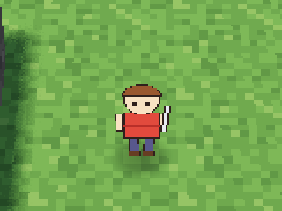

# Character sprites

Characters are 2D sprites in the 3D world, like in Ragnarok Online. Each sprite turns to face the camera but stays upright, and a soft round shadow sits on the ground under its feet.



## How it fits together

`scenes/actors/CharacterVisual.tscn` is the look of one character. Put an instance of it under any character body, at the feet. `Player.tscn` has one, named `Visual`.

| Node | Type | Role |
| --- | --- | --- |
| `CharacterVisual` | `Node3D` | Root, at the character's feet |
| `Sprite` | `AnimatedSprite3D` + `CharacterSprite` | The character. Billboard is **Y-Billboard**, so it turns around Y only and never leans back under the 45° camera |
| `BlobShadow` | `Decal` | A dark radial gradient projected down onto the ground. It follows slopes and ramps |

- `Ragna.Core.Characters.CharacterAnimator` (`scripts/core/Characters/`) has the rules. It has no Godot dependency and is tested in `tests/Ragna.Core.Tests/Characters/`.
- `CharacterSprite` (`scripts/gameplay/Characters/`) reads the speed of the nearest `CharacterBody3D` above it every frame. It plays `walk` above **Walk Speed Threshold** (0.1 m/s) and `idle` below it.
- Call `PlayAttack()` on the sprite to play `attack` once, from the first frame. It plays over idle and walk, then the sprite goes back to idle or walk. Nothing calls it yet; click-to-attack combat (GAM-10) will.

## Sprite settings

| Setting | Value | Why |
| --- | --- | --- |
| Billboard | Y-Billboard | Faces the camera, stays upright |
| Pixel Size | 0.018 m | A 96 px frame is 1.73 m tall, the height of the player's collision capsule |
| Position | Y = 0.864 m | Half the sprite height, so the feet touch the ground |
| Shaded | Off | Sprites keep their own colours; the light doesn't darken them |
| Alpha Cut | Discard | Sorts correctly against other sprites and the terrain |
| Texture Filter | Nearest | Crisp pixel art |
| Cast Shadow | Off | The blob shadow replaces the real one |
| Layers | 2 | Keeps the blob shadow off the sprite (see below) |

## Blob shadow

The `BlobShadow` decal is 0.9 m wide and reaches 0.5 m above and below the feet. Its **Cull Mask** has every layer except layer 2, so it draws on the terrain but not on character sprites. Put new character sprites on render layer 2 too.

To change the shadow, edit the `Gradient` in `CharacterVisual.tscn`: the centre is 60 % black, and it fades to clear at the edge.

## Animations

The sprite's `SpriteFrames` must have these three animations:

| Name | Loops | Placeholder frames | Placeholder speed |
| --- | --- | --- | --- |
| `idle` | Yes | 4 | 4 fps |
| `walk` | Yes | 6 | 10 fps |
| `attack` | No | 4 | 10 fps |

`attack` must not loop: the sprite goes back to idle or walk when it ends.

The placeholder art is `assets/characters/placeholder/`: a sprite sheet with 64×96 px frames, one row per animation, feet on the bottom pixel row, and `placeholder_frames.tres`, the `SpriteFrames` cut from it. Regenerate both with:

```sh
python3 tools/characters/make_placeholder_sprites.py   # needs Pillow
```

To use real art, make a new `SpriteFrames` with the same three animation names and set it as **Sprite Frames** on the `Sprite` node. Keep the feet on the bottom row of each frame, or move `Sprite` up or down to match.
