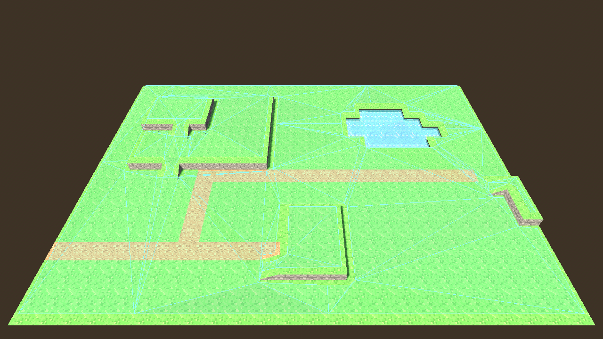

# Click-to-move and navigation

Left-click the ground to walk there. The player finds a path around cliffs and ponds and takes the ramps up to the plateaus.
Hold the button to keep walking towards the cursor. Release it, and the player finishes the walk to the last point.

## Controls

| Input | Action | Input map action |
| --- | --- | --- |
| Left mouse button | Walk to the clicked ground | `move` |
| Hold left mouse button | Keep walking towards the cursor | `move` |

Clicks on a cliff wall or a pond still work: the player walks to the nearest point it can reach.
Clicks that miss the terrain (the sky) do nothing.

## How it fits together

| Node | Where | Role |
| --- | --- | --- |
| `Navigation` (`NavigationRegion3D`) | each map, e.g. `scenes/maps/TestMap.tscn` | Holds the baked navmesh. The terrain `GridMap` is its child, because the bake reads the region's children |
| `Player` (`CharacterBody3D`) | `scenes/actors/Player.tscn`, placed in `Main.tscn` | Runs `ClickToMoveController` |
| `NavigationAgent` (`NavigationAgent3D`) | child of `Player` | Finds the path on the navmesh |

- `Ragna.Core.Movement.ClickToMove` (`scripts/core/Movement/`) has the rules: a click sets the destination; holding asks for a new path at most every 0.1 s, and only when the cursor point moved at least 0.25 m; the walk speed never overshoots a waypoint. It has no Godot dependency and is tested in `tests/Ragna.Core.Tests/Movement/`.
- `ClickToMoveController` (`scripts/gameplay/Movement/`) turns the cursor into a ray from the camera, hits the terrain (physics layer 1), and walks the agent's path at **Move Speed** (5 m/s). After each step a short ray down puts the player back on the ground.
- The player walks the path directly instead of using physics (`MoveAndSlide`). The navmesh already keeps it away from cliffs and water, and a capsule would snag on the open sides of ramps.
- The water surface has no collision, so clicks and the bake pass through it to the pond bed. The bed is 0.5 m down, deeper than the 0.25 m step limit, so ponds are cut out of the navmesh.

## Navmesh settings

These values are used by `tools/terrain/TerrainBuilder.cs` (`CreateNavigationMesh`). Use the same values when you bake a map in the editor.

| Inspector group | Property | Value | Why |
| --- | --- | --- | --- |
| Geometry | Parsed Geometry Type | **Static Colliders** | Bake from the tile collision, which leaves out the water surface |
| Geometry | Collision Mask | layer **1** only | Terrain |
| Cells | Size / Height | **0.25** / **0.25** | Must match **Project Settings > Navigation > 3D** (defaults) |
| Agents | Height | **1.7** | Player capsule |
| Agents | Radius | **0.35** | Player capsule; keeps paths this far from cliff edges |
| Agents | Max Climb | **0.25** | Cliffs (1 m) and pond beds (0.5 m) are not walkable |
| Agents | Max Slope | **45** | Grass slopes are about 27° |
| Filters | Ledge Spans | **On** | Paths join a ramp near its low edge, not over its side |

The baked navmesh floats 0.5 m above the ground. That is normal for these cell sizes, so the player's `NavigationAgent` has **Path Height Offset** set to **0.5**.
If you change the cell height, rebake, then check where the navmesh sits (**Debug > Visible Navigation**) and update that offset to match.

## The test map

`scenes/maps/TestMap.tscn` is generated. `tools/build_terrain.sh` rebuilds it and bakes its navmesh, so you don't need the editor for it.
See [terrain.md](terrain.md#regenerating-the-assets).

## Baking a navmesh in the editor

Use these steps for a map you painted by hand (see [terrain.md](terrain.md#painting-a-new-map-in-the-editor)).
Baking needs the editor, or a script like the test map builder.

1. Open the project in Godot 4.7 (.NET) and open your map scene, for example `scenes/maps/Meadow.tscn`.
2. Add the region:
   1. In the Scene dock, select the root node.
   2. Click **+** (Add Child Node), search for `NavigationRegion3D`, and click **Create**.
   3. Double-click the new node and rename it to `Navigation`.
3. Put the terrain under it: in the Scene dock, drag the `GridMap` node onto `Navigation`. It is now indented under `Navigation`.
4. Create the navmesh resource:
   1. Select `Navigation`.
   2. In the Inspector, click the **Navigation Mesh** slot (it says `<empty>`) and choose **New NavigationMesh**.
   3. Click the new `NavigationMesh` to unfold its properties.
5. Set the properties from the [Navmesh settings](#navmesh-settings) table:
   1. **Geometry > Parsed Geometry Type**: pick **Static Colliders**.
   2. **Geometry > Collision Mask**: click the grid of numbered boxes so that only **1** is highlighted.
   3. **Cells > Size**: `0.25`. **Cells > Height**: `0.25`.
   4. **Agents > Height**: `1.7`. **Radius**: `0.35`. **Max Climb**: `0.25`. **Max Slope**: `45`.
   5. **Filters > Ledge Spans**: tick it.
6. Bake: with `Navigation` still selected, click **Bake NavigationMesh** in the toolbar at the top of the 3D viewport.
   A light blue mesh appears over the walkable ground. If nothing appears, check that the `GridMap` is a child of `Navigation` and that its **Collision > Layer** includes layer 1.
7. Check the result. Cliff tops and the ground below them must be separate areas, joined only by ramps. Ponds must be holes.
   To see it while playing, tick **Debug > Visible Navigation** in the editor menu, then run the game.
8. Save with **Ctrl+S**. The navmesh is stored inside the scene.
9. Rebake (step 6) every time you repaint the map. The navmesh does not follow GridMap changes on its own.

To play the map, swap it into `scenes/Main.tscn` as described in [terrain.md](terrain.md#painting-a-new-map-in-the-editor). The player in `Main.tscn` uses whatever navmesh is in the scene.
