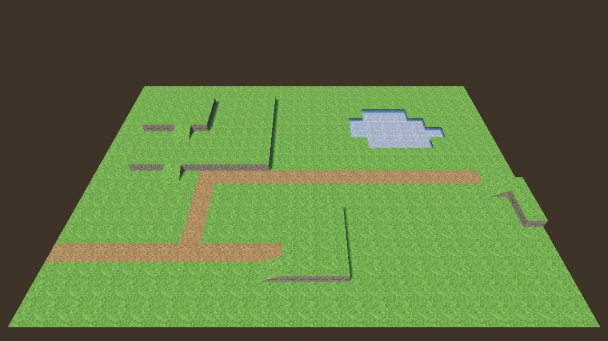

# Terrain

Maps are built from a `GridMap` that paints tiles from one `MeshLibrary`:
`assets/terrain/terrain_tiles.tres`.



## Tiles

| ID | Tile | What it is |
| --- | --- | --- |
| 0 | Grass (flat) | Grass floor at ground level |
| 1 | Dirt path (flat) | Dirt floor at ground level |
| 2 | Grass slope (rises to -Z) | Ramp up one height step. Rotate it to face other ways |
| 3 | Cliff block | Full-height block with a grass top and rock sides |
| 4 | Water | Sand bed with a translucent water surface just below ground level |

The IDs are stored in painted maps. Never renumber them; only add new tiles at the end
(`scripts/core/Terrain/TerrainTile.cs`).

Every tile has a collision shape, so mouse picking and navmesh baking can use it.

### Grid settings

Use these settings on every terrain `GridMap`:

| Property | Value |
| --- | --- |
| Cell > Size | `(2, 1, 2)`: cells are 2 m wide and one height step is 1 m |
| Cell > Center Y | Off |
| Cell > Center X / Center Z | On (default) |

With these settings, ground level is y = 0. A cliff on floor 0 has its top at y = 1, which is ground level for floor 1.

### Look

- Textures are 16 x 16 pixel placeholders in `assets/terrain/textures/`, one repeat per cell.
- The materials in `assets/terrain/materials/` use **Nearest Mipmap** filtering, so the pixels stay crisp.
- `TestMap.tscn` has a soft sun: a `DirectionalLight3D` with a 3° angular size (blurred shadow edges) plus sky ambient light.

## Regenerating the assets

Tile geometry, textures and the test map layout are plain C# in `scripts/core/Terrain/` and have unit tests.
The Godot assets are generated from them:

```sh
tools/build_terrain.sh          # set GODOT=/path/to/godot if it isn't on PATH
```

The script:
- writes any **missing** PNGs and materials, and keeps existing ones, so you can replace the art by hand;
- **always** rebuilds `terrain_tiles.tres` and `scenes/maps/TestMap.tscn`.

Don't hand-paint `TestMap.tscn`, because the script overwrites it. To change the test map, edit
`scripts/core/Terrain/TestMapLayout.cs` (the symbols are documented in `TerrainMapLayout.cs`) and run the script again.
Paint new maps in their own scenes, as shown below.

## Painting a new map in the editor

1. Open the project in Godot 4.7 (.NET). Click **Build** (hammer icon, top right) once so the C# scripts compile.
2. Click **Scene > New Scene**. In the Scene dock, click **3D Scene**. Rename the root node by double-clicking it, for example to `Meadow`.
3. Add the lighting. The easiest way is to copy it from the test map:
   1. Open `scenes/maps/TestMap.tscn` from the FileSystem dock.
   2. In the Scene dock, Ctrl-click `WorldEnvironment` and `Sun`, then press **Ctrl+C**.
   3. Switch back to your new scene's tab, select the root node and press **Ctrl+V**.
4. Add the grid. Select the root node, click **+** (Add Child Node), search for `GridMap`, and click **Create**.
5. With the `GridMap` selected, set these properties in the Inspector:
   1. **Mesh Library**: drag `assets/terrain/terrain_tiles.tres` from the FileSystem dock onto the slot.
   2. **Cell > Size**: `x = 2`, `y = 1`, `z = 2`.
   3. **Cell > Center Y**: untick it.
6. Save the scene with **Ctrl+S**, as `scenes/maps/<name>.tscn`.
7. Paint the ground:
   1. With the `GridMap` selected, the **GridMap** panel opens at the bottom of the editor. It shows the five tiles. If it shows names only, that's fine, because the generated library has no preview icons.
   2. Click **Grass (flat)** in the panel.
   3. Move the mouse over the 3D viewport. Left-click to paint one cell, or left-drag to paint a row.
   4. Right-click a cell to erase it.
   5. To fill a rectangle, pick the **Select** tool in the GridMap toolbar (or hold **Shift** in paint mode) and drag across the area. Then press **Ctrl+F** (**Fill Selection**) to fill it with the selected tile.
8. Paint paths and water: click **Dirt path (flat)** or **Water** in the panel and paint over the grass. Painting over a cell replaces its tile.
9. Raise a plateau: click **Cliff block** and paint it on floor 0 where the high ground should be.
10. Add a ramp up to it:
    1. Click **Grass slope (rises to -Z)**.
    2. Hover a ground cell next to the cliff. By default the ramp rises towards -Z, away from the default camera.
    3. Press **S** to rotate it 90° around Y; press until the high edge touches the cliff. (**Shift+S** rotates the other way and **W** clears the rotation. **A** / **D** rotate around X / Z, which terrain doesn't need.)
    4. Left-click to place it.
11. Build a second floor:
    1. Press **E** to move the editing floor up one level (**Q** moves it down). The floor number shows in the GridMap toolbar.
    2. Paint **Cliff block** or **Grass slope** tiles on top of the floor-0 cliffs. Upper-floor tiles must sit on a cliff, or they float.
    3. Press **Q** to return to floor 0 when you are done.
12. Look at the result: press **F** in the viewport to frame the selection. Use the **Perspective** menu (top left of the viewport) for preset angles.
13. Save with **Ctrl+S**.

To play a map, open `scenes/Main.tscn`, select the `TestMap` node, and in the Inspector click the scene icon to replace it with your map. Or press **F6** with your map open to run just that scene. Your new map has no camera yet; GAM-4 adds the game camera. To preview it without the game camera, copy `PreviewCamera` from `TestMap.tscn`, as in step 3.

## Code

| Path | Role |
| --- | --- |
| `scripts/core/Terrain/TerrainTile.cs` | Tile IDs and surface types |
| `scripts/core/Terrain/TerrainTileGeometry.cs` | Low-poly placeholder meshes and UV projection |
| `scripts/core/Terrain/TerrainTexture.cs` | Placeholder pixel textures |
| `scripts/core/Terrain/TerrainMapLayout.cs` | ASCII map format |
| `scripts/core/Terrain/TestMapLayout.cs` | The test map |
| `scripts/gameplay/Terrain/TerrainMeshBuilder.cs` | Turns core geometry into Godot `ArrayMesh`es |
| `tools/terrain/TerrainBuilder.cs` | Headless builder that writes the textures, materials, MeshLibrary and test map |
